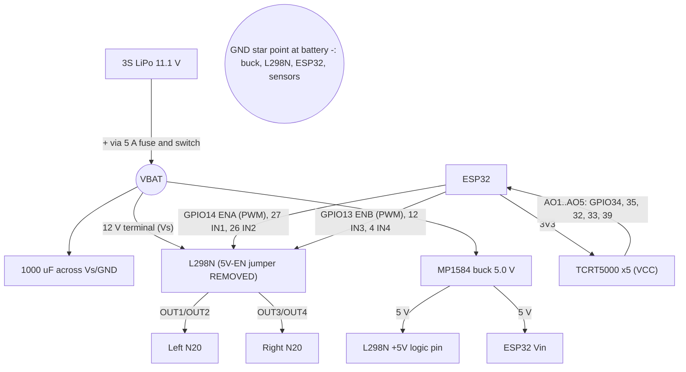

# Datasheet literacy + wiring + troubleshooting (Tasks 2 and 6)

> Figures below are from the ST L298 datasheet as I know it; **re-open the PDF and confirm each number before submitting** (the interview will ask).

## Task 2 - L298N (dual full-bridge driver)
**Parameters that constrain the design**
1. **Output current: 2 A DC per channel (peak 2.5-3 A, short pulses).** N20 stall ~0.8 A -> 2.5x margin; this is why a 12 V N20 is paired with it and why no heavier motor was chosen. It also sets the fuse (5 A) and max PWM strategy.
2. **Voltage drop (saturation, source+sink) ~1.8 V at 1 A, ~2.5 V at 2 A.** Motors see ~9.3 V from 11.1 V. Consequence: 12 V motors (not 6 V), speed calculated at 9.3 V (0.52 m/s), and a cost: ~1.5 W of heat per channel at stall.
3. **Logic: Vss 4.5-7 V; input low <=1.5 V, input high >=2.3 V.** ESP32 3.3 V GPIO meets V_IH, so no level shifter is needed - but the chip's logic supply cannot be 3.3 V; it needs 5 V (from the buck). Motor supply Vs up to 46 V, so 12.6 V full 3S is fine for the chip.

**Condition that would damage it, and avoidance**
* *Over-current / over-temperature* (stall > 2 A, or a short): thermal shutdown exists, but repeated trips degrade the part. Avoided by 12 V N20 motors with 0.8 A stall, a 5 A fuse upstream, a heatsink (module), PWM cap, and firmware that stops after 1.2 s of lost line (no endless pushing against a wall).
* *Over-voltage on the 5 V pin / regulator:* the module's 78M05 is rated ~12 V in with the jumper; a charged 3S is 12.6 V. I remove the jumper and feed 5 V from a buck set and **measured at 5.0 V before connecting the ESP32**.
* *Inductive kickback:* L298 has no internal flyback diodes; the module has 1N4007s. They are slow for PWM, so keep PWM at 5 kHz and add a 1000 uF cap on Vs (optionally 1N5819 Schottky diodes).

## Appendix A pin-map review (things I changed and why)
| Issue | Why it matters | Fix |
|---|---|---|
| IN4 on **GPIO11** | GPIO6-11 connect to the module's SPI flash; driving them crashes/reboots the ESP32 | IN4 -> GPIO4 (`APPENDIX_STRICT_PINS` flag restores literal map) |
| IR_S5 on **GPIO25** labelled ADC1_CH8 | GPIO25 is **ADC2_CH8**; ADC2 cannot be used while Wi-Fi is active (Task 7) | S5 -> GPIO39 (ADC1_CH3, input only) |
| IN3 on **GPIO12** | MTDI strap pin: HIGH at boot selects 1.8 V flash -> boot loop | 10 k pull-down to GND |
| GPIO34/35/39 input-only | no internal pull-ups/outputs; fine for analog | none |
| ADC default attenuation | default range ~0-1.1 V | `analogSetAttenuation(ADC_11db)` for 0-3.3 V; ADC is nonlinear near rails, handled by min-max calibration |
| `analogWrite` | only exists in Arduino-ESP32 core 3.x | LEDC shim for 2.x and 3.x |

## Task 6 - wiring diagram

* **Voltages:** 11.1-12.6 V battery/motor; 5.0 V buck -> ESP32 Vin and L298N logic; 3.3 V ESP32 LDO -> IR modules (analog outputs therefore never exceed 3.3 V, safe for the ADC).
* **Common ground** is mandatory: logic signals are measured relative to GND, so the ESP32, driver and sensors must share it. Topology: star at the battery/buck input; the motor return current (amps, noisy) runs on its own thick wire to the star, not through the ESP32 ground trace.
* **Driver role:** GPIO pins can supply ~tens of mA; motors need amps at battery voltage. The H-bridge is a power switch: `INx` pairs choose polarity (10 = forward, 01 = reverse, 00 = coast, 11 = brake), `EN` PWM sets average voltage = speed.

## Troubleshooting: ESP32 resets when the motors engage
**Probable root causes (ranked):** (1) battery/wiring voltage sag at motor start (inrush up to stall, ~1.6 A) dips the 5 V rail below the ESP32 brownout threshold (~2.4-2.6 V at the chip; devkit AMS1117 needs >~4.4 V in) because logic and motor current share thin wires/connectors; (2) shared ground impedance: motor return current lifts the ESP32 ground; (3) inductive spikes coupling into 5 V; (4) buck current limit/under-spec; (5) weak or low battery; (6) loose Dupont connectors.
**First diagnostic:** read the reset reason at boot (`esp_reset_reason()` -> `ESP_RST_BROWNOUT` vs `ESP_RST_PANIC`/`ESP_RST_POWERON`) and, with a multimeter min-hold or scope, watch the 5 V pin at the ESP32 while commanding a motor start. Reset reason brownout + dip on 5 V confirms a power problem, not firmware.
**Fix:** 1000 uF at Vs and 470 uF at the ESP32 5 V, short thick motor wires, soldered/screw-terminal power joints, star ground, motor ramp (limit PWM slew), battery charged.
**Confirm:** 5 V dip stays <100 mV during 30 consecutive full-speed start/stop cycles, zero brownout resets logged, and the same test at a half-charged battery.
