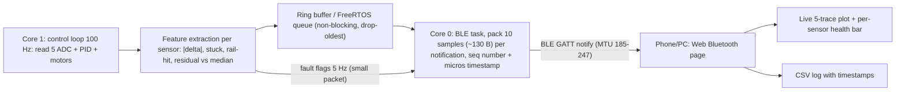

# Wireless sensor diagnostics (Task 7)

## 1. Protocol: BLE (GATT notifications)
Data rate needed is tiny: 5 x 2 B + 2 B timestamp + 1 B flags ~ 13 B/sample x 100 Hz ~ **1.3 kB/s (~10 kbps)**. So bandwidth is not the deciding factor; the others are.

| | Wi-Fi | Classic BT (SPP) | **BLE** |
|---|---|---|---|
| Throughput | >1 Mbps | ~100+ kB/s | ~10-100 kB/s (enough) |
| Latency | low but bursty (AP, retries) | ~10-30 ms | ~15-50 ms (conn. interval 7.5-15 ms) |
| Current | ~100-240 mA peaks | ~40-100 mA | ~10-30 mA average |
| ESP32 side effect | **ADC2 unusable while Wi-Fi on** (S5 on GPIO25!), big RAM/CPU load | ~60 kB RAM, SPP is easy | ~30-50 kB RAM |
| Phone/PC | needs AP or soft-AP | Android/PC only, **no iOS** | Android, iOS, PC; **Web Bluetooth** dashboard in Chrome, no app |
| Ease | medium | easiest (looks like Serial) | medium |

**Choice: BLE.** Lowest power on a battery robot (draw from the same 5 V rail that must not brown out, see Task 6), no ADC2 conflict with the IR array, works with any phone/PC through a web page, and 15-50 ms latency is invisible for fault diagnosis. Trade-off: GATT is more work than SPP; for bench-only debugging Classic BT SPP would be the quicker hack. Wi-Fi is rejected mainly for ADC2 and power spikes.

## 2. Architecture

**Why this is safe for the robot:** the control loop only writes to a queue; if BLE stalls, samples are dropped, never the PID loop. Sequence numbers let the viewer show packet loss separately from sensor faults.

**How the faulty sensor is identified without touching it.** The bumps shake *all* sensors together (common-mode), while a bad sensor/connection misbehaves alone (differential). Per sample, on the ESP32:
1. Compute the median of the five normalised values; residual_i = s_i minus the expected value from its neighbours.
2. Flag *spike*: |s_i[k]-s_i[k-1]| > 0.5 while the other four changed < 0.15.
3. Flag *rail-hit*: raw < min-margin or at 4095/0 (open wire/short) for >=2 samples.
4. Flag *stuck*: variance ~0 over 1 s while the others vary.
5. Health score_i = decayed count of flags; the dashboard colours any sensor above threshold red and prints "S3: 7 dropouts / 10 s". A bump shows as a simultaneous dip on several traces and is *not* counted against any single sensor.
A 2 s on-board snapshot buffer, frozen when a flag fires and sent afterward, gives a trace around the event.
